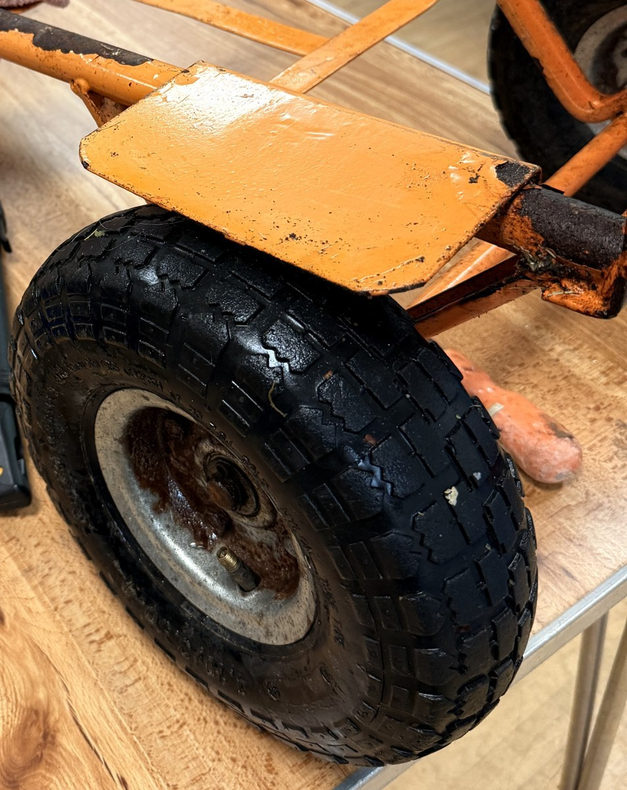
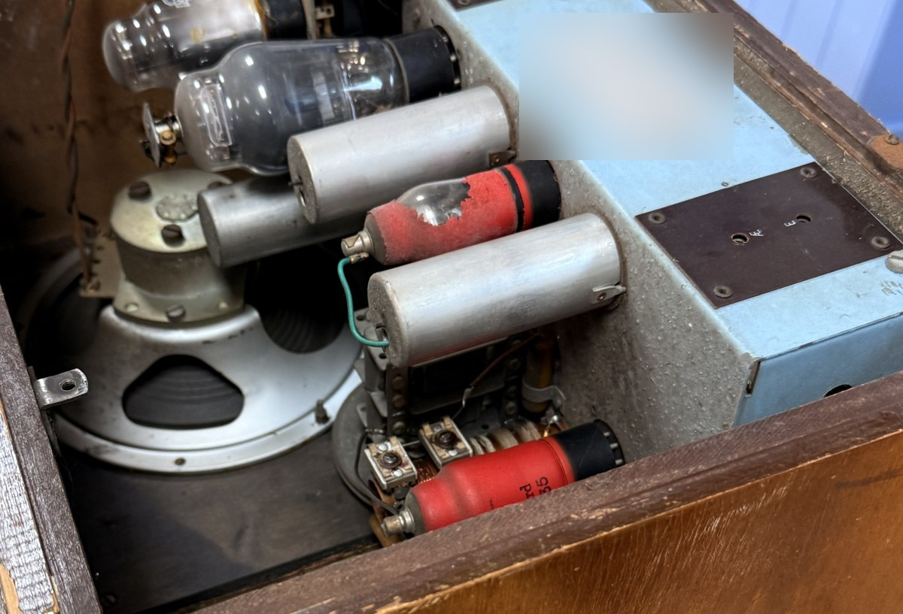
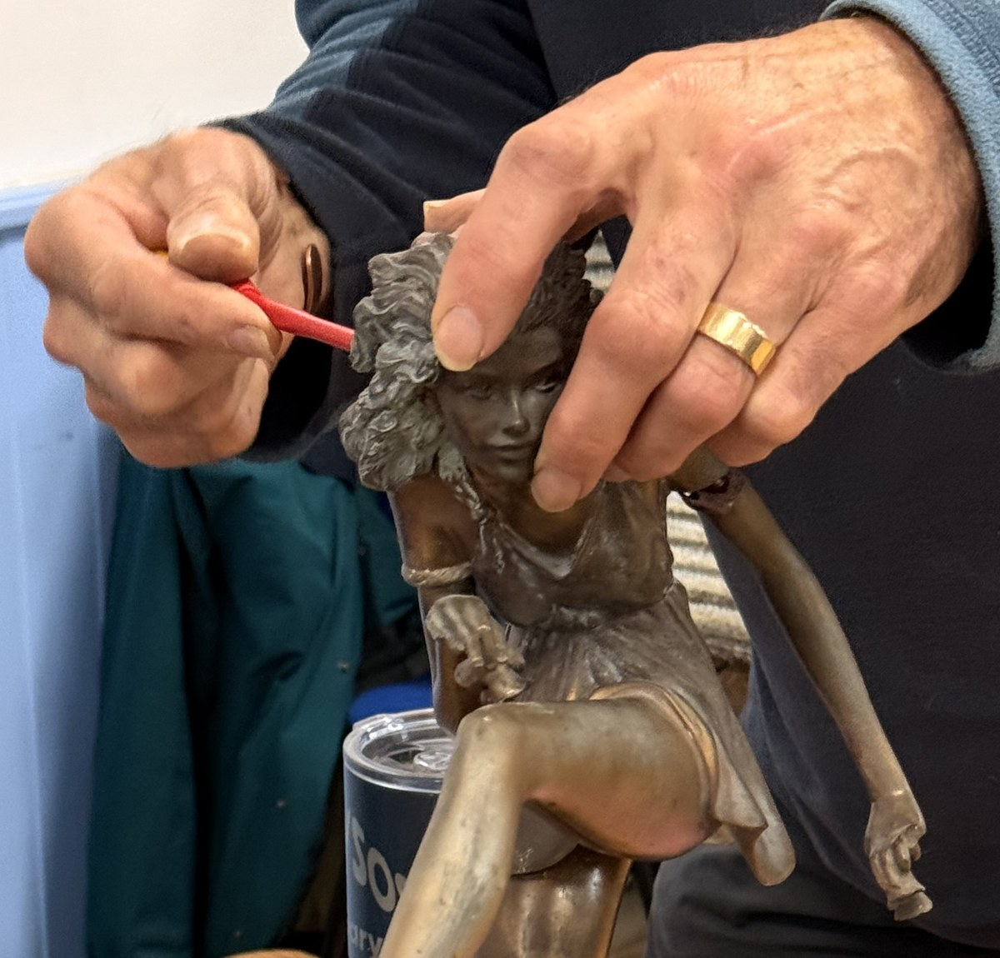

October’s Repair Café at Tregony Village Hall on Saturday 24th October included clothing repairs, household appliances, tools and jewellery. We recorded 15 successful jobs, with seven of them at the sewing table.

The textile repairs included a patched jacket sleeve, new elastic in jersey shorts and a top, and a new zip in denim shorts. A coat hood was altered, a rucksack zip restitched, and trousers had their hems and crotch seam repaired.

Elsewhere, a pruning saw needed a replacement nut and bolt, and a kettle’s stuck lid was freed. Chair castors, a clock and a drill driver were repaired too. A bicycle had new brake pads fitted, and a necklace and earrings were repaired.

Not everything could be fixed. A VHS/DVD player, a radio from the 1940s, an SDS drill and a television remained unrepaired.

Some work is continuing beyond the café. A bedside lamp needing a new switch and a fairy statue with a broken wing were taken away for repair. A table lamp is waiting for a new fitting.

Thank you to everyone who brought something along and to the volunteers who helped with the repairs and running the café.

## Next Repair Café

Our next Repair Café is on **Saturday 21 November, from 1–3pm**, in the **Main Hall at Tregony Village Hall**. Bring along something you’d like help repairing—we’ll be pleased to take a look.
